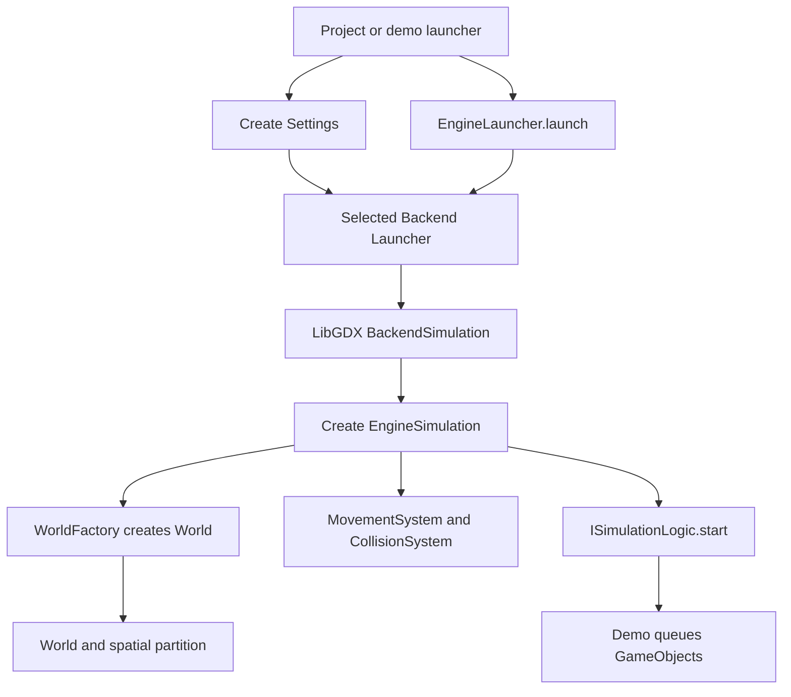
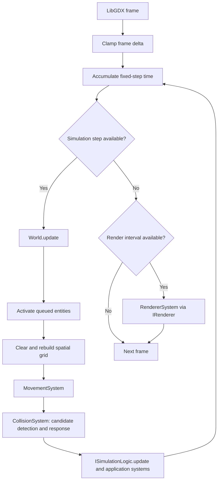

# Layered Architecture and Execution Flow

PhysicsEngine is intended to be a reusable engine for projects with different application goals. It separates engine rules, project/demo behavior, and platform code. The main boundary is interface-based: application logic depends on engine contracts and the engine uses renderer/input interfaces instead of depending on LibGDX classes. A layer should depend on the contract it needs, not on the concrete implementation behind that contract.

This is an architectural direction, not a claim that every dependency is fully inverted today. In particular, `WorldFactory` currently chooses concrete board, collision, and grid-partition implementations, and `EngineSimulation` constructs its core systems.

## Layers

| Layer | Main packages | Responsibility | May depend on |
|---|---|---|---|
| Engine-based projects | `yourproject.*` | Host application-specific behavior and compose a project using the engine. The top-level `yourproject` package is currently reserved and empty. | Public engine APIs, components, systems, and interfaces. |
| Reference demos | `demos.*` | Show example uses of the engine. Current examples are the particle simulation and Pong; neither defines the engine's product scope. | Public engine APIs, components, systems, and interfaces. |
| Engine orchestration | `engine.app` | Launch a simulation, construct its world and core systems, and coordinate updates and rendering. | Engine contracts and abstract backend-launcher types, not LibGDX implementation classes. |
| Engine core/domain | `engine.ecs`, `engine.world`, `engine.physics`, `engine.math` | Hold entity state and implement simulation, geometry, and collision rules. | Core contracts and math. The current `WorldFactory` is a known concrete-binding point. |
| Ports/contracts | `engine.app.implementation`, `engine.graphics.interfaces`, `engine.inputs` | Define how custom simulations, renderers, cameras, and key input connect to the engine. | Domain types used in the contracts. |
| Backend adapters | `backend.libgdx` | Adapt LibGDX lifecycle, rendering, camera, and keyboard input to engine interfaces. | LibGDX and engine contracts. |

### Dependency rule

- A project or demo should not import LibGDX classes. It describes application behavior using `ISimulationLogic`, `Settings`, ECS components, and systems.
- The engine's rendering boundary is `IRenderer`; input is exposed through `IKeyInput`. The LibGDX adapter implements these boundaries.
- The backend can call engine abstractions, but physics and ECS rules should not rely on backend classes.
- Concrete choices belong near a composition point: a launcher/backend selector chooses the platform adapter, and `WorldFactory` currently chooses supported world collaborators.
- When adding a new implementation, prefer injecting it through an existing interface or factory boundary rather than branching on backend details throughout the engine.

## What Is a System?

A system is a unit of behavior that processes entities with a required set of components. Components hold data; systems read or change that data. For example, `MovementSystem` selects entities with `TransformComponent` and `PhysicsComponent`, while `RendererSystem` selects entities with `TransformComponent` and `RendererComponent`.

`SystemECS` is the base class. A system declares its required component types in its constructor and implements `processGameObject(dt, gameObject)` for per-entity work, or overrides `processUpdate` when it needs a custom pass such as collision-pair collection. The base class filters entities by component signature and optionally dispatches work through a shared thread pool.

System order matters because systems can mutate shared component data. In the core update, movement runs before collision resolution; demo-specific `ISimulationLogic.update` runs after both. Collision detection can be parallel, but the current collision response is sequential to avoid concurrent mutation of the same entities.

## Initialization Flow

The demo launcher is the configuration/composition entry point. It builds `Settings` and supplies an `ISimulationLogic` implementation. The backend creates platform adapters and the engine controller. The simulation's `start` method creates demo-owned entities and custom systems; `World.addEntity` queues each entity until the next update.

## Per-Frame Execution Flow

`BackendSimulation` owns the fixed-step accumulators and frame-time clamp. `EngineSimulation.update(dt)` itself runs one world update, movement, collision, then demo logic. Rendering is a separate call on its own configured interval. The diagram describes the intended ordering; exact accumulator loop details live in `backend/libgdx/app/BackendSimulation.java`.

## How the Engine Works

1. A `GameObject` receives components. `ComponentRegistry` assigns each component type an ID, and the entity maintains a bit signature of its components.
2. `World` owns active entities, the board, collision strategy, and spatial partition. Additions are queued and become active at the next `World.update`.
3. `MovementSystem` updates velocity and position for entities that have the required components.
4. `CollisionSystem` queries nearby grid cells to find possible pairs, asks the selected `Collision` strategy to test them, and resolves overlaps.
5. The demo's logic and systems apply application-specific rules.
6. `RendererSystem` finds renderable entities and sends their shapes, positions, and colors to `IRenderer`.

The current collision strategy is `ElasticCollision` and handles circles end to end. `ColliderComponent` can represent an AABB, but rectangular collision checks and response are not yet implemented. `WorldFactory` also currently constructs `ToroidalGridPartition` for either board type; the selected `Board` determines boundary and distance behavior.

For the distinction between the empty project area and reference examples, see [Projects and Reference Demos](../NEW_DEMO.md). The `src/main/java/yourproject` directory is intentionally reserved for actual engine-based projects; `src/main/java/demos` remains example code.